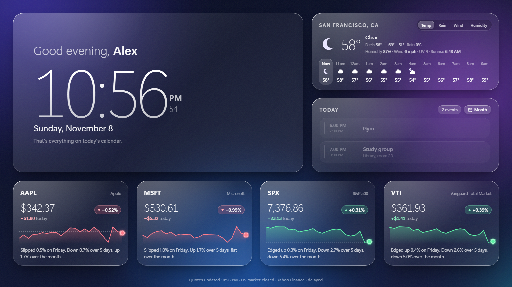
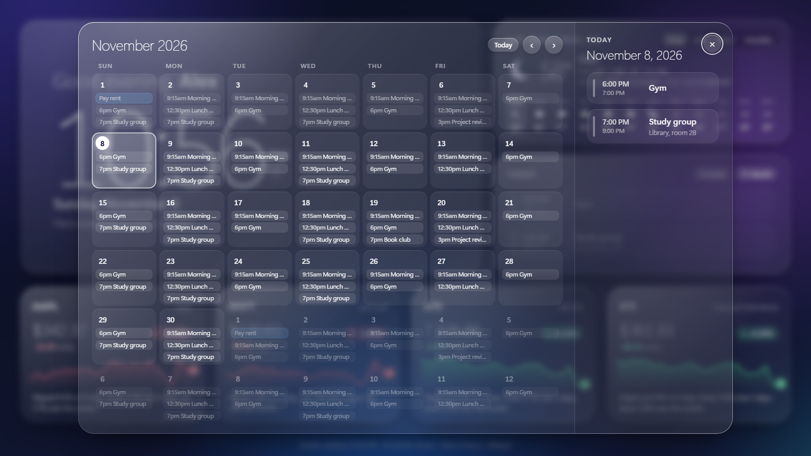

# Glass Dashboard

A liquid-glass start screen for Windows. It opens fullscreen when you sign in, unlock, or wake your PC, and shows your day at a glance.



- **Clock and greeting:** "Good morning / afternoon / evening, *your name*". The background colors shift with the time of day.
- **Weather:** current conditions, today's high and low, and a 12-hour forecast you can switch between **Temp / Rain / Wind / Humidity**.
- **Today's calendar:** events from Google Calendar (or any iCal feed), with "Now" and "in 20 min" tags.
- **Month view:** a Google Calendar–style month grid. Click any day to see its events.
- **Stocks:** any tickers you like, each with price, day change in $ and %, a 1-month chart you can hover, and a one-line summary of how it moved.



No accounts, no API keys, no frameworks: a small Python server using only the standard library, plus plain HTML, CSS and JavaScript.

## Requirements

- Windows 10 or 11
- [Python 3.9+](https://www.python.org/downloads/). Tick "Add python.exe to PATH" during install.
- Microsoft Edge, which comes with Windows

## Quick start

1. **Download** this repo with **Code → Download ZIP** and unzip it somewhere permanent, like `Documents\glass-dashboard`. Or clone it:
   ```bash
   git clone https://github.com/AryanG41/glass-dashboard.git
   ```
2. **Open it once** by double-clicking `start-dashboard.vbs`. On first run it creates `config.json` from `config.example.json`.
3. **Make it yours:** edit `config.json` (see below), then press **Alt+F4** and double-click `start-dashboard.vbs` again.
4. **Optional: open it automatically.** In the folder, right-click `install-startup.ps1` → **Run with PowerShell**. Or run:
   ```powershell
   powershell -ExecutionPolicy Bypass -File install-startup.ps1
   ```

Press **Alt+F4** to close the dashboard.

## Configuration (`config.json`)

```json
{
  "name": "Alex",
  "port": 47613,
  "tickers": [
    { "symbol": "AAPL",  "label": "AAPL", "name": "Apple" },
    { "symbol": "^GSPC", "label": "SPX",  "name": "S&P 500" }
  ],
  "weather": { "place": "San Francisco, CA", "units": "fahrenheit" },
  "ical_url": ""
}
```

| Setting | What it does |
|---|---|
| `name` | The name in the greeting. |
| `tickers` | Any [Yahoo Finance](https://finance.yahoo.com) symbols: stocks (`AAPL`), ETFs (`VTI`), indexes (`^GSPC`, `^IXIC`), crypto (`BTC-USD`). `label` is shown on the card and `name` under it. Up to 6 fit in a row. Use `[]` to hide the stocks row. |
| `weather.place` | A city, like `"Austin, TX"`, `"London, UK"` or `"Tokyo"`. The location is looked up automatically. For an exact spot, add `"latitude"` and `"longitude"` instead. Remove the `weather` block to hide the card. |
| `weather.units` | `"fahrenheit"` (°F, mph) or `"celsius"` (°C, km/h). |
| `ical_url` | Your calendar. One link, a list of links (`["…", "…"]`), or a path to a local `.ics` file. To try it out, use `"examples/sample-calendar.ics"`. |
| `port` | The local port. If you change it, change `PORT` at the top of `start-dashboard.vbs` too. |

`config.json` is in `.gitignore`, so your private calendar link and location never get committed.

### Connecting Google Calendar

1. On [calendar.google.com](https://calendar.google.com) (on a computer), open ⚙ **Settings**, pick your calendar under **Settings for my calendars**, then go to **Integrate calendar**.
2. Copy **Secret address in iCal format** (it ends in `basic.ics`).
3. Paste it as `ical_url` in `config.json`.

That link gives read-only access to your calendar, so keep it private. If it leaks, click **Reset** next to it in Google Calendar settings. Google can take a few hours to show new events in this feed.

Notes:
- **Google Tasks** (the items with a circle icon) are not included in iCal feeds. Make them events if you want them on the dashboard.
- **Outlook / iCloud** work too. Use their "publish calendar" / "public calendar" ICS link.

## Using it

| Action | How |
|---|---|
| Month view | **Month** button on the calendar card |
| Change month | **‹ ›**, the **← →** keys, or the scroll wheel over the grid |
| Jump to today | **Today** button, or **T** |
| See a day's events | Click the day |
| Close month view | **Esc**, **×**, or click outside it |
| Hourly forecast details | **Temp / Rain / Wind / Humidity** toggle |
| Price on a past day | Hover over a stock's chart |
| Close the dashboard | **Alt+F4** |

## Auto-start: what gets installed

`install-startup.ps1` adds two things, and both run `start-dashboard.vbs`:

1. **A Startup shortcut** that opens the dashboard when you sign in: `%APPDATA%\Microsoft\Windows\Start Menu\Programs\Startup\Glass Dashboard.lnk`
2. **A scheduled task, "Glass Dashboard (wake)"**, that opens it when you unlock the PC or wake it from sleep. It works with classic sleep and with Modern Standby. It runs only as you and only while you're signed in.

If the dashboard is already open, the launcher brings it to the front instead of opening a second copy. It makes no registry edits and installs no services.

**To remove everything**, run `uninstall-startup.ps1`. It deletes the shortcut and the task and stops the server. You can also delete `%LOCALAPPDATA%\GlassDashboard`, which holds the dashboard's separate Edge profile.

## How it works

| File | Role |
|---|---|
| `start-dashboard.vbs` | Launcher. Starts the server hidden, then opens Edge in fullscreen kiosk mode with its own profile. |
| `server.py` | Local server on `127.0.0.1` only. Fetches stocks (Yahoo Finance), weather (Open-Meteo) and your calendar, with short caching. |
| `public/app.js` | Clock, greeting, stock cards, today's events |
| `public/weather.js` | Weather card |
| `public/month.js` | Month view |
| `public/ical.js` | A small iCalendar reader: time zones, all-day and multi-day events, repeating events (daily, weekly, monthly, yearly), exceptions, and moved or cancelled instances |
| `install-startup.ps1` / `uninstall-startup.ps1` | Add or remove auto-start |

The server runs in the background with almost no overhead. To run it in a terminal while you work on the page, use `python server.py` and open http://127.0.0.1:47613. Add `#month` to the URL to open the month view directly.

## Limitations

- Yahoo Finance's chart endpoint is free but unofficial, and quotes can be delayed by about 15 minutes. If it changes, the stock cards say "Quote unavailable" and the rest of the dashboard keeps working.
- The stock summaries are generated from price data. They aren't news.
- Rare calendar repeat rules (BYSETPOS, BYWEEKNO, hourly repeats) are skipped.
- Windows only for auto-start and the launcher. On macOS or Linux you can still run `python server.py` and open the page in a browser.

## Credits

Weather from [Open-Meteo](https://open-meteo.com) (CC BY 4.0). Market data from Yahoo Finance. Not affiliated with either.

## License

[MIT](LICENSE)
